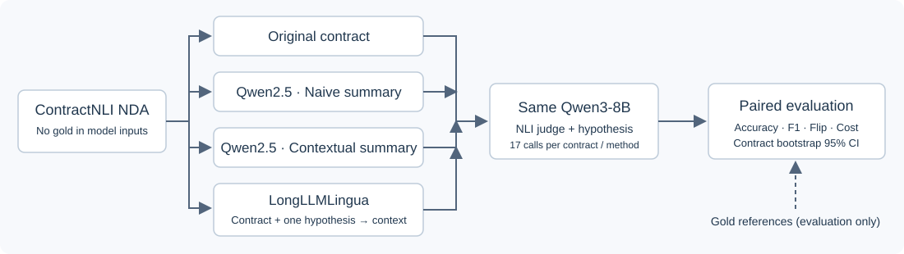
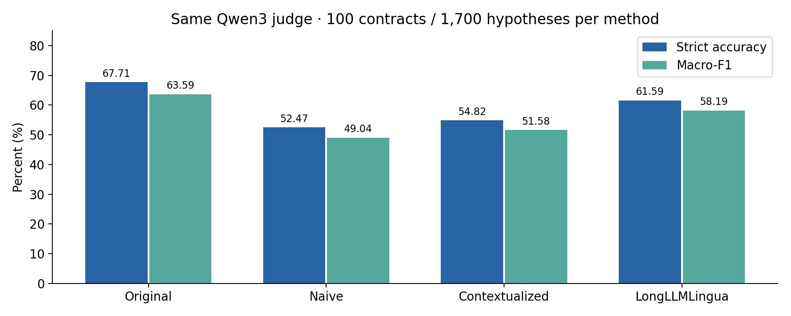
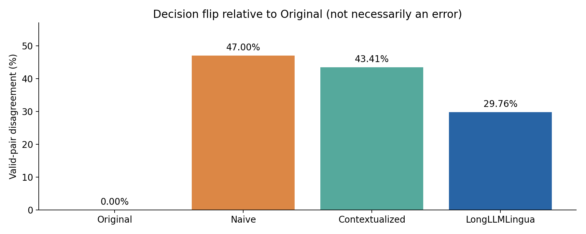
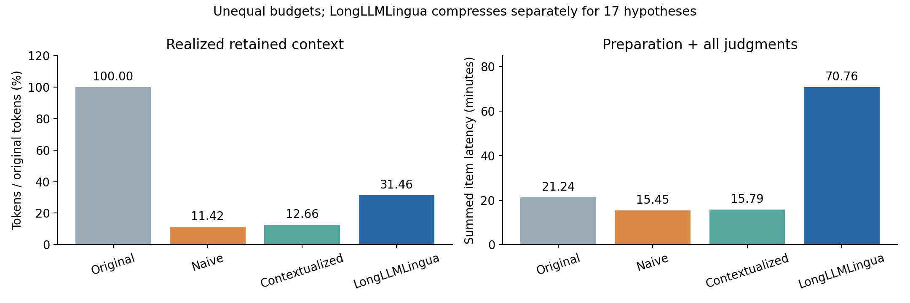
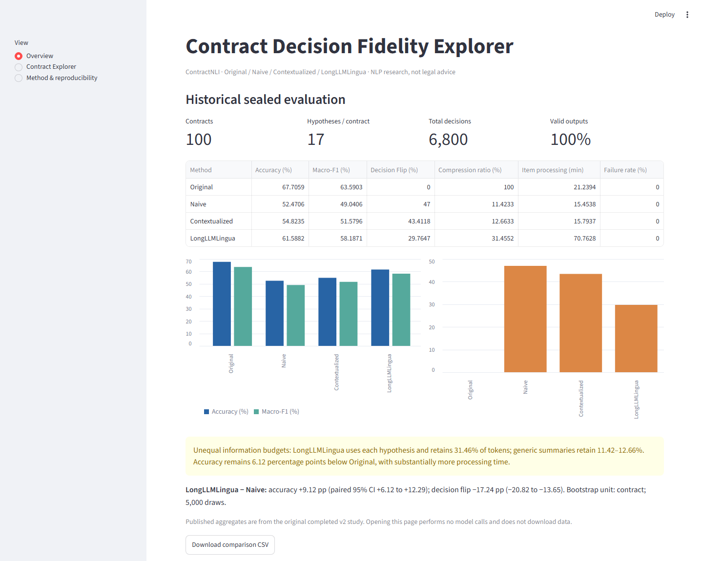

# Contract Decision Fidelity

**When does compressing a contract change an NLP model's decision?**

LongLLMLingua achieved **+9.12 percentage points accuracy** and **−17.24 pp decision flip** versus Naive on **100 contracts / 1,700 hypotheses per method**, with **6,800 total judgments** and **31.46% realized token retention**.

These are historical, measured v2 results—not new experiments performed for this release. The comparison uses **different information budgets and question conditioning**. LongLLMLingua remained **6.12 pp below Original accuracy** and increased total processing time. This project does not provide legal advice.

[한국어 안내](docs/README_ko.md) · [Results and limitations](reports/results_summary.md) · [Release audit](reports/public_release_audit.md) · [Third-party notices](THIRD_PARTY_NOTICES.md)



## Motivation and key idea

A fluent summary may remove the exception, condition, negation, or time limit that determines whether a legal hypothesis is supported. We compare one unchanged NLI judge on the original NDA, two generic summaries, and a hypothesis-conditioned LongLLMLingua context. Decision flip measures disagreement with the original-input judge; it is **not necessarily an error**. Accuracy is measured separately against original ContractNLI annotations.

## Architecture

- `src/`: preserved shared data schemas, official data audit, Ollama interface, NLI output schema and evaluation functions.
- `cdfv2/`: validated v2 summaries, question-aware compression, single-hypothesis decisions, resumable runners and aggregate evaluation.
- `configs/`, `prompts/`: pinned settings, data/model hashes, unchanged prompts.
- `results/published/`: immutable historical aggregate JSON/CSV; no contracts or quotes.
- `results/{smoke,development,sealed}/`: ignored, locally generated reproduction checkpoints.
- `app/`: offline aggregate dashboard and optional local contract explorer.

The two code namespaces preserve the original tested implementation while removing its cross-project imports. No sibling project is required. This is a source-checkout application: install it editable and keep configs/prompts alongside the package.

## Dataset

[ContractNLI](https://stanfordnlp.github.io/contract-nli/) contains 607 NDAs and 17 fixed hypotheses: Entailment, Contradiction, NotMentioned. Official splits contain 423/61/123 documents. The data is CC BY 4.0, with accompanying terms. **No raw contracts, summaries, compressed contract text, or evidence quotes are distributed here.** The downloader retrieves the official archive and verifies its frozen SHA-256.

The already-observed official Test split is not reused as an independent v2 evaluation. Historical v2 used 100 sealed Train documents and a development pool of 323, with actual development inference on a fixed 24. IDs exposed in earlier individual statistics were excluded from sealed candidates. Train-wide aggregate exposure and unrecorded/pretraining exposure limit independence. Downloading/reproducing this completed experiment does not create a new independent test.

## Models

| Role | Model | Configuration |
|---|---|---|
| Summaries | Qwen2.5-7B-Instruct | Ollama `qwen2.5:7b-instruct`, Q4_K_M |
| NLI judge, all methods | Qwen3-8B | Ollama `qwen3:8b`, Q4_K_M, non-thinking |
| LongLLMLingua scorer | NousResearch/Llama-2-7b-chat-hf | pinned revision, NF4 double quantization, FP16 compute |

Digests are in `configs/experiment.json`. The validated runtime is Ollama **0.40.2**, context 32,768, temperature 0, seed 20261015. Model/runtime mismatches stop execution. Current model tags can change; an unmatched tag is not an exact reproduction. Weights are downloaded separately and governed by their own licenses.

## Installation

Validated platform: Windows, Python 3.10, RTX 5080 16 GB, 32 GB RAM. GPU stages are sequential. CPU-only environments can run tests, evaluation, and the aggregate dashboard; the compressor requires CUDA. Linux has not been independently validated in this release.

```powershell
python -m venv .venv
.venv\Scripts\Activate.ps1
python -m pip install torch==2.8.0 --index-url https://download.pytorch.org/whl/cu128
python -m pip install -e .
```

On POSIX, activate with `source .venv/bin/activate`. Choose a compatible PyTorch CUDA build for your GPU; exact historical validation used `2.8.0+cu128`. Keep Transformers 4.46.3 and Accelerate 0.33.0: the official LongLLMLingua 0.2.2 path relies on legacy KV-cache behavior. See [installation details](docs/installation.md) and `docs/original_environment.lock.txt`.

## Quick start: no models or dataset required

```powershell
python -m cdfv2.cli --help
python -m cdfv2.cli verify
python scripts/verify_public_files.py
python -m cdfv2.cli status
python -m pytest -q
python -m streamlit run app/streamlit_app.py --server.address 127.0.0.1
```

`verify` verifies the published files against the historical source hashes. The dashboard does not contact Ollama when browsing stored results. Tests requiring optional local assets report a skip when those assets are absent.

## Reproducing experiments

Install [Ollama](https://github.com/ollama/ollama/releases/tag/v0.40.2), then in a separate terminal:

```powershell
$env:OLLAMA_HOST="127.0.0.1:11436"
ollama serve
```

In the project terminal (the `.env.example` file is documentation; it is not loaded automatically):

```powershell
$env:OLLAMA_HOST="127.0.0.1:11436"
$env:CDF_OLLAMA_URL="http://127.0.0.1:11436"
ollama pull qwen2.5:7b-instruct
ollama pull qwen3:8b
python -m cdfv2.cli runtime-check
python -m cdfv2.cli download
python -m cdfv2.cli assets
python -m cdfv2.cli audit
```

Read the [Llama 2 license and acceptable-use terms](THIRD_PARTY_NOTICES.md) before downloading the compressor (about 13.5 GB of weight files):

```powershell
python -m cdfv2.cli assets --compressor
python scripts/release_smoke.py
```

The release smoke makes two summaries, one question-aware context and four real judgments for one development document/hypothesis. It records outputs locally, does not score a new study, and refuses to overwrite an earlier smoke run.

For the historical full protocol:

```powershell
python scripts/run_experiment.py --split development
python -m cdfv2.cli evaluate --split development
python -m cdfv2.cli lock
python scripts/run_experiment.py --split sealed
python -m cdfv2.cli evaluate --split sealed
```

Development includes 15% and 30% LongLLMLingua budgets. The public reproduction **retains the historical 30% choice**; it does not select again after observed results. The reproduction lock is distinct from the original experimental lock. Successful checkpoints are reused only with matching fingerprints and input hashes. Do not edit frozen files during a run. `run --split ... --stage summary/compress/judge --method ...` exposes individual stages. There is no final-test `--limit` option.

The exact 6,800 original raw predictions are preserved in the private source project, not shipped here because they contain quotes. Public aggregates can be hash-verified offline; reproducing individual predictions requires the data and local models. Hardware/runtime nondeterminism can still affect regeneration. No claim is made that release smoke regenerated the historical study.

## Results

| Method | Strict accuracy | Macro-F1 | Decision flip | Error introduced | Token retention | Item processing min |
|---|---:|---:|---:|---:|---:|---:|
| Original | 67.71% | 63.59% | 0.00% | 0.00% | 100.00% | 21.24 |
| Naive | 52.47% | 49.04% | 47.00% | 28.53% | 11.42% | 15.45 |
| Contextualized | 54.82% | 51.58% | 43.41% | 25.82% | 12.66% | 15.79 |
| LongLLMLingua | 61.59% | 58.19% | 29.76% | 15.76% | 31.46% | 70.76 |

All conditions have 100% valid label output. Quote validity is a separate, imperfect formal check. Item processing sums preparation and NLI latencies; full observed stage wall times including process/model loading were 21.60 / 15.99 / 16.32 / 71.81 minutes. No paid API was used; electricity was not measured. Compressor forward-token counts and Qwen token counts use different tokenizers and are reported separately.





Paired 95% CIs resample **contracts**, retaining their 17 hypotheses together, 5,000 times. LongLLMLingua minus Naive accuracy: +9.12 pp [6.12,12.29]; minus Original: −6.12 pp [−8.24,−4.12]. Full metrics and class-wise support are in `results/published/sealed.json`.

## Streamlit dashboard



Overview works from published aggregates alone. Contract Explorer activates after official data preparation; summaries, compressed contexts and predictions appear after local reproduction. Gold evidence is highlighted using original offsets, never sent to the model. Missing outputs are shown as `NOT_RUN` or their failure status.

## Limitations

- The advantage over Naive is not isolated from a larger retained context and access to the hypothesis.
- Original accuracy is only 67.71%; fidelity to this judge does not imply correctness.
- Accuracy loss exceeds the planned 3 pp goal; realized retention exceeds the 30% target.
- Question-specific compression makes 17 compressor runs per contract and costs more overall here.
- One judge, one summary model, related Qwen models and 17 fixed hypotheses limit generalization.
- Formal evidence matching cannot establish semantic preservation; original gold annotations are not newly annotated summary labels.
- Historical v1 had 629 failed judgments from 37 failed document-method summaries across 30 unique contracts. v2 changes both formatting/retries and hypothesis batching; cross-version gains must not be attributed to compression alone.

## References

- [ContractNLI, Koreeda and Manning (2021)](https://aclanthology.org/2021.findings-emnlp.164/)
- [LongLLMLingua, Jiang et al. (ACL 2024)](https://aclanthology.org/2024.acl-long.91/) and [official implementation](https://github.com/microsoft/LLMLingua)
- [When Summaries Distort Decisions](https://arxiv.org/abs/2606.29251): inspiration for decision fidelity, adapted to contract NLI. Full ACC, multiple judges and TVD reproduction are outside scope.
- [Qwen2.5-7B-Instruct](https://huggingface.co/Qwen/Qwen2.5-7B-Instruct), [Qwen3-8B](https://huggingface.co/Qwen/Qwen3-8B)

## License

Project code is released under the [MIT License](LICENSE), authorized by the project rights holder during release preparation. Third-party model and data licenses are independent; no model weights or raw data are bundled. See [THIRD_PARTY_NOTICES.md](THIRD_PARTY_NOTICES.md).
